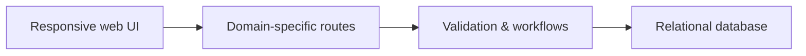

# AgentHub API

**Automation / Rules Engine** · Python · FastAPI · SQLite · Portfolio case study

> A deterministic, configurable rules-based agent execution API with audit history, without paid AI services.

### At a glance

| | |
| --- | --- |
| **Core workflow** | Configure rules → execute input → inspect audit log |
| **Highlights** | Deterministic ordered keyword rule evaluation and execution history |
| **Persistence** | Local SQLite database |
| **Maturity** | Functional portfolio MVP — not production hardened |


## Engineering edition: measurable behaviour

- **Live read-only reporting:** `GET /api/insights` derives aggregates from stored business data (not hard-coded numbers).
- **Review path:** [Five-minute walkthrough](docs/DEMO.md) · [API reference](docs/API.md) · [Engineering decisions](docs/ENGINEERING.md).
- **License:** MIT. **Operational maturity:** local educational MVP, not an internet-facing production service.
- **Container:** `docker compose up --build` binds the demo to `127.0.0.1` and stores its SQLite file in a persistent named volume.

## Product capabilities

- Create rule-based agents using keyword → response rules
- Run an agent against input text
- Fallback replies and match reporting
- Persist and inspect execution history

## Architecture



### Design decisions

- **Domain-specific modelling:** the entities and routes reflect a real automation / rules engine workflow rather than generic records.
- **Portable setup:** the application can be run locally with documented tooling; no paid external API keys are required.
- **Explicit boundaries:** this is a demonstrable MVP. Auth, tenancy, logging, scalability and operational security need additional engineering before production use.

## Local development

```bash
python -m venv .venv
# Activate the environment, then:
pip install -r requirements.txt
uvicorn main:app --reload
```
Open http://localhost:8000 for the demo, or http://localhost:8000/docs for API documentation.

Rules are case-insensitive substring matches, evaluated in their configured order. This is **not** a language model or autonomous AI agent.

## Tests

```bash
python -m pip install -r requirements-dev.txt
python -m unittest discover -s tests -v
```

The GitHub Actions workflow runs integration tests of real API behaviour. These tests cover representative workflows and validations; they do not imply comprehensive security or load testing.

## API and UX

The project provides a browser-based demo and REST API documentation at `/docs`. See the application source for concrete endpoints. No hosted demo is claimed.

## Roadmap

- Rule versioning; scoped API keys.
- Authentication, authorisation, secure secrets management, and deployment configuration.
- Database migrations and backups where not already available, along with comprehensive accessibility and end-to-end testing.

## Security and scope

Local demonstration only; do not deploy publicly with real customer data as-is. The `.env.example` documents configuration; do not commit `.env`, credential files, database files, or third-party API keys. See [SECURITY.md](SECURITY.md).

## Project maintenance

- [CONTRIBUTING.md](CONTRIBUTING.md) — development conventions and review expectations
- [.github/workflows/checks.yml](.github/workflows/checks.yml) — automated checks
- [CHANGELOG.md](CHANGELOG.md) — release notes
